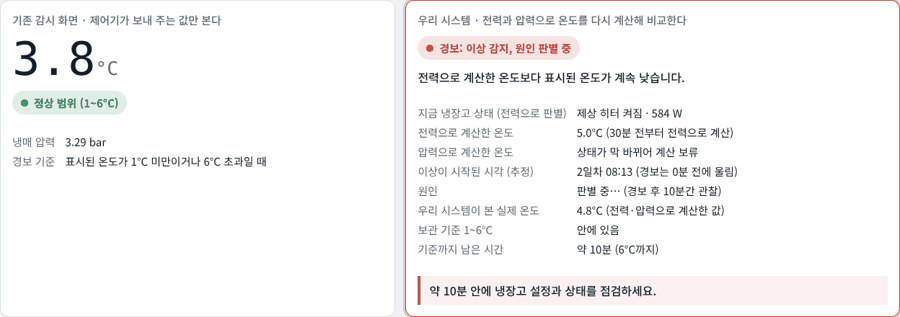
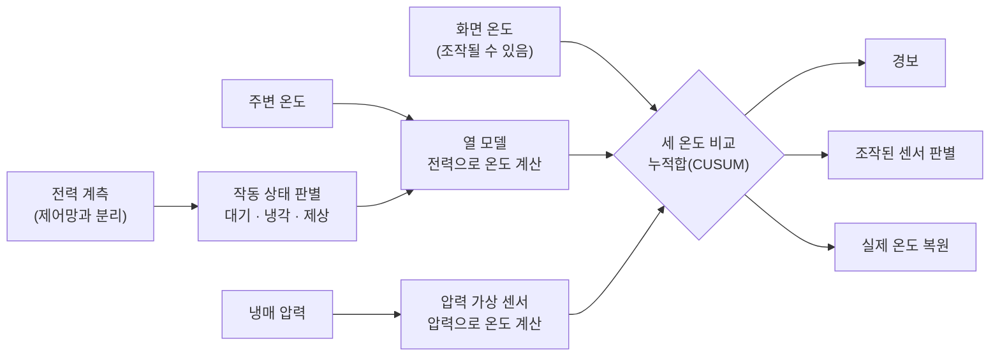
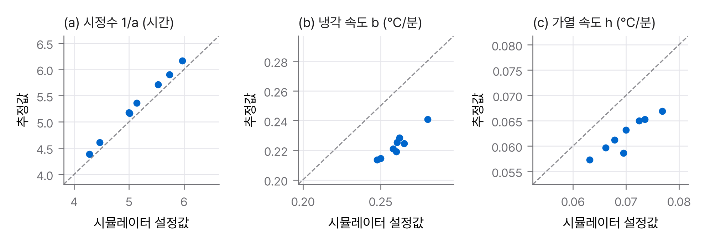
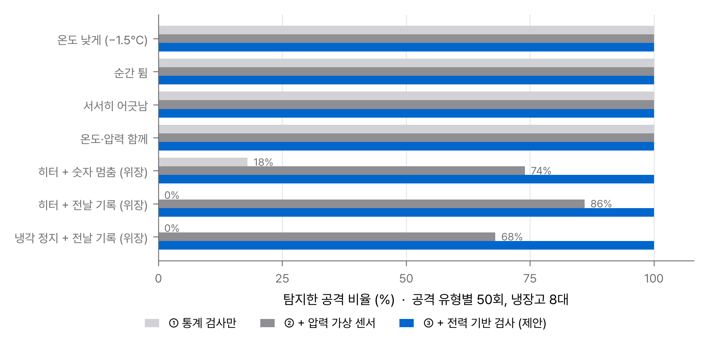
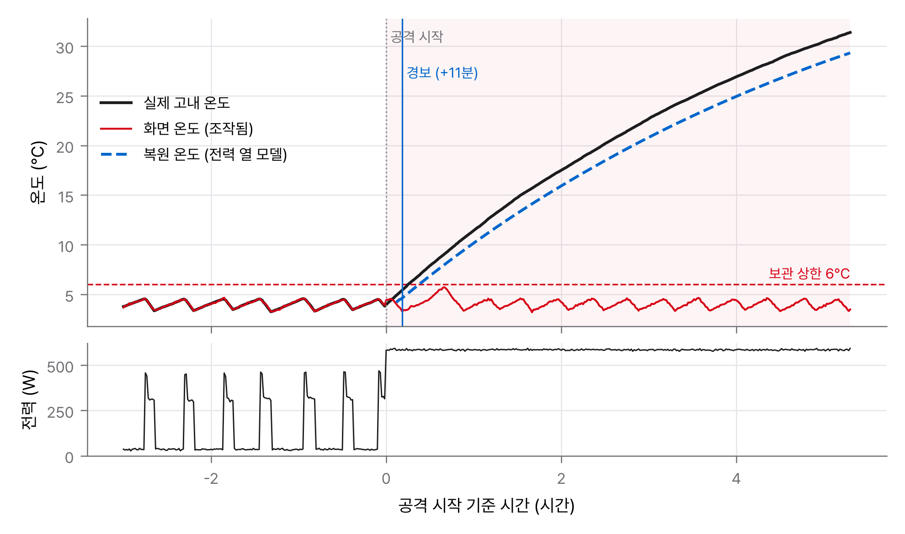
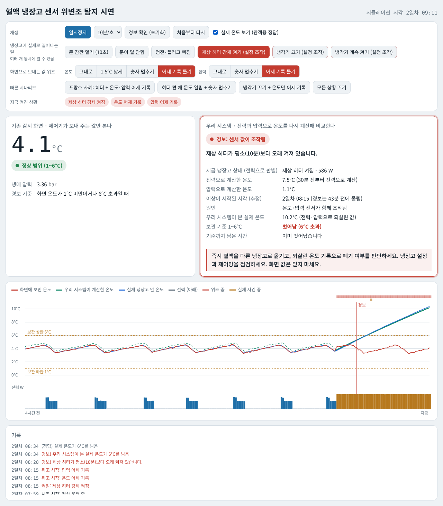

<div align="center">

# 전력 계측 기반 혈액 냉장고<br>센서 위변조 탐지 및 실제 온도 복원

**해커가 온도 센서 값을 정상처럼 조작해도, 해커가 바꿀 수 없는 전력으로 실제 온도를 다시 계산합니다.**

2026 ADSA+ AI·보안 융합 정보보호 아이디어톤 · 주제 1. ICS/OT 센서 데이터 위변조 탐지 및 복원<br>
영남대학교 정보통신공학전공 · 팀 라이프라인


[](https://blood-fridge-tamper-detection.jfldjd.workers.dev)

**[시연 바로가기](https://blood-fridge-tamper-detection.jfldjd.workers.dev)** · [동작 원리](#동작-원리) · [결과](#결과) · [실험 재현](#실험-재현)



<sub>실제 시연 화면. 히터를 몰래 켜고 온도·압력 센서 값을 조작하면 기존 감시 화면(왼쪽)은 계속 "정상"이지만, 제안 시스템(오른쪽)은 전력으로 계산한 온도와 비교해 경보를 울리고 실제 온도를 되살린다.</sub>

</div>

<br>

<table>
<tr>
<td align="center" width="25%"><h3>150 / 150</h3>정상처럼 위장한 공격 탐지<br><sub>통계 검사만 쓰면 9 / 150</sub></td>
<td align="center" width="25%"><h3>8~12분</h3>위장 공격 경보까지<br><sub>중앙값</sub></td>
<td align="center" width="25%"><h3>0.07회 / 일</h3>오경보<br><sub>정상 운전 약 627일</sub></td>
<td align="center" width="25%"><h3>0.9~1.5°C</h3>실제 온도 복원 오차<br><sub>화면 온도는 6.5~13.2°C 차이</sub></td>
</tr>
</table>

<sub>가상 혈액 냉장고 8대, 공격 7종 × 50회 = 350회, 문 여닫기는 현장 조건.</sub>

## 왜 필요한가

- 2026년 10\~11월 유럽 슈퍼마켓과 프랑스 혈액원 냉장설비의 온도·제상 설정이 원격으로 조작되었다.
- 현장의 감시(냉장고 본체 경보 + 별도 디지털 온도계)는 모두 **온도 센서를 믿는다.** 해커가 센서 값까지 조작하면 경보가 울리지 않는다.
- 적혈구는 1\~6°C에서 보관한다. 히터가 켜지면 약 15분, 냉각이 멈추면 약 35분 만에 6°C를 넘는다.

## 동작 원리



| 단계 | 하는 일 |
| --- | --- |
| **1. 전력 → 작동 상태** | 가우시안 혼합 모델(GMM)이 라벨 없이 대기(약 35 W)·냉각(약 300 W)·제상 히터(약 590 W 이상)를 구분한다. |
| **2. 열 모델** | 아래 물리식과 머신러닝 보정으로, 30분 전 온도에서 지금 온도를 계산한다. 계수 $`a, b, h`$는 냉장고마다 정상 데이터에서 추정한다. |
| **3. 압력 가상 센서** | 냉매 압력과 작동 상태로 고내 온도를 따로 추정한다. |
| **4. 비교·판별·복원** | 화면 온도와 계산 온도의 차이를 매분 누적해 기준선을 넘으면 경보를 울리고, 세 온도를 맞춰 조작된 센서와 시작 시각을 찾은 뒤 실제 온도를 복원한다. |

**열 모델 (1분 단위)**

```math
T_{k+1} = T_k + a\,(T_{a,k} - T_k) - b\,u_k + h\,d_k
```

$`T_k`$: 고내 온도, $`T_{a,k}`$: 주변 온도, $`u_k`$: 압축기 작동(0/1), $`d_k`$: 제상 히터 작동(0/1), $`a`$: 열 손실 계수, $`b`$: 냉각 속도, $`h`$: 가열 속도. $`u_k`$와 $`d_k`$는 전력으로 판별한 작동 상태에서 얻는다.

<p align="center"></p>

<sub>냉장고 8대의 열 모델 계수: 시뮬레이터 설정값과 정상 데이터만으로 추정한 값. 시정수는 2\~4% 차이로 맞고, 냉각·가열 속도는 9\~16% 작게 잡힌다.</sub>

> GRU 신경망 단독은 학습 범위 밖의 공격 상황(30°C까지 상승)에서 6°C 근처에 멈췄다. 그래서 물리식을 뼈대로 두고 AI는 상태 판별과 보정에 썼다 (`results/gpu/`).

## 결과

| 항목 | 결과 |
| --- | --- |
| 전체 공격 탐지 | **350 / 350** |
| 정상처럼 위장한 공격 탐지 | **150 / 150** (통계 검사만 9 / 150, 압력 추가 114 / 150) |
| 위장 공격 경보까지 | 중앙값 8\~12분 (냉장고별 5\~17분) |
| 오경보 | 하루 0.07회 |
| 실제 온도 복원 오차 (위장 공격 구간) | 6.5\~13.2°C → **0.9\~1.5°C** |
| 조작 시작 시각 추정 오차 | 1\~4분 |
| 원인 센서 판별 | 순간 튐 공격 제외 300 / 300 |
| HMAC 변조·재전송 차단 | 117 / 117, 정상 오차단 0 / 1,883 |

<p align="center"></p>

<sub>구성별·공격 유형별 탐지율. 숨기지 않은 공격 4종은 세 구성 모두 100%이고, 위장 공격 3종에서만 차이가 난다.</sub>

<p align="center"></p>

<sub>히터 강제 가동 + 전날 기록 재생 공격. 화면 온도(빨강)는 4°C 근처에 머물지만, 전력 열 모델로 복원한 온도(파란 점선)는 실제 온도(검정)를 따라간다. 아래는 독립 모듈이 잰 전력.</sub>

문 여닫기는 혈액은행 근무 임상병리사 자문값(주간 시간당 3\~4회, 10초 이내)을 썼다. 자세한 내용은 보고서에 있다.

## 시연

**[시연 바로가기](https://blood-fridge-tamper-detection.jfldjd.workers.dev)** · `demo/index.html` 한 파일로 브라우저에서 동작한다(설치·인터넷 불필요).

문 열림, 정전, 히터 강제 가동, 냉각기 정지 같은 실제 사건과 온도·압력 값 조작을 여러 개 동시에 켜서, 기존 감시 화면과 제안 시스템의 판단을 나란히 비교한다.

<details>
<summary><b>전체 화면 보기</b></summary>
<br>

</details>

<details>
<summary><b>시연 화면 고치기</b></summary>

`demo-src/`의 `core.js`(시뮬레이터·탐지 엔진)와 `ui.html`(화면)을 고친 뒤 `demo/index.html`을 다시 만든다.

```bash
cd demo-src
node calib.js          # 탐지 기준 재보정 (cfg.json 갱신, 선택)
python3 build.py       # demo/index.html 생성
```
</details>

## 실험 재현

```bash
cd simulation
pip install -r requirements.txt
python step1_generate.py   # 냉장고 8대 데이터 생성
python step2_train.py      # 냉장고별 학습·경보 기준 (약 20분)
python step3_evaluate.py   # 공격 350회 평가
python step4_plots.py      # 그림 → simulation/results/
python paper_figs.py       # 보고서·README 그림 → simulation/results/paper_figs/
```

<details>
<summary><b>조건 바꾸기 · GPU 비교</b></summary>

문 여닫기 조건은 환경 변수 `DOOR_MODE`로 바꾼다 (`real` 기본 = 현장 조건, `stress` = 이전 가혹 조건). GPU 비교는 `gpu_compare.py`, `gpu_hybrid.py` (PyTorch, CUDA 필요). 자세한 설명은 [simulation/README.md](simulation/README.md).
</details>

<details>
<summary><b>폴더 구조</b></summary>

```
├── demo/              # 시연 페이지
├── demo-src/          # 시연 페이지 소스 (엔진, 화면, 보정)
├── simulation/        # 가상 냉장고·공격·탐지·복원 실험 코드
├── results/
│   ├── field/         # 현장 조건 결과 (본 결과)
│   ├── stress/        # 이전 가혹 조건 결과 (문 1~3분)
│   └── gpu/           # GRU·하이브리드 비교 (가혹 조건)
└── docs/              # 보고서(docx), 그림
```
</details>

## 한계

- 모든 데이터는 가상 데이터다 (대회 규정).
- 위장 공격 150회 중 12회(주로 히터 공격)는 경보 전에 이미 6°C를 넘었다.
- 문으로 들어오는 열은 전력으로 알 수 없다.
- 냉매 누설 같은 고장은 아직 포함하지 않았다.

<details>
<summary><b>참고문헌</b></summary>

- E. S. Page, “Continuous inspection schemes,” *Biometrika*, 1954.
- A. A. Cárdenas et al., “Attacks against process control systems: risk assessment, detection, and response,” *ACM ASIACCS*, 2011.
- D. I. Urbina et al., “Limiting the impact of stealthy attacks on industrial control systems,” *ACM CCS*, 2016.
- 사건 경위: BleepingComputer(2026-11-04), The Record, Help Net Security 보도.

전체 참고문헌은 보고서에 있다.
</details>

## 팀 라이프라인

영남대학교 정보통신공학전공 · 이승준(팀장), 이준우, 변정호, 신한철, 이종원 · 지도교수 박우길(컴퓨터학부)
